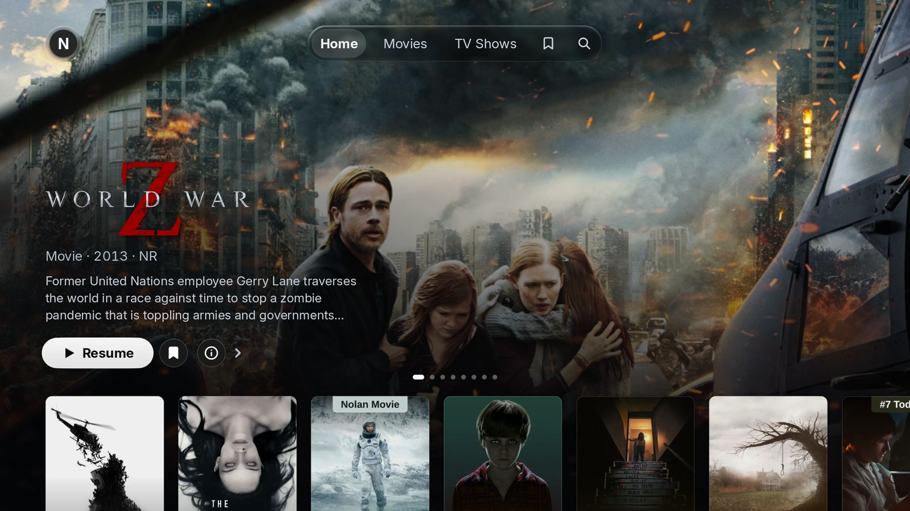
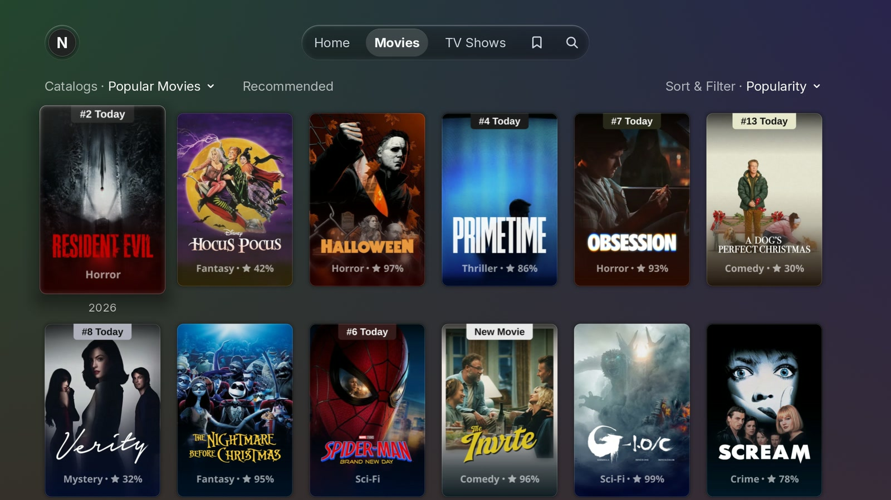
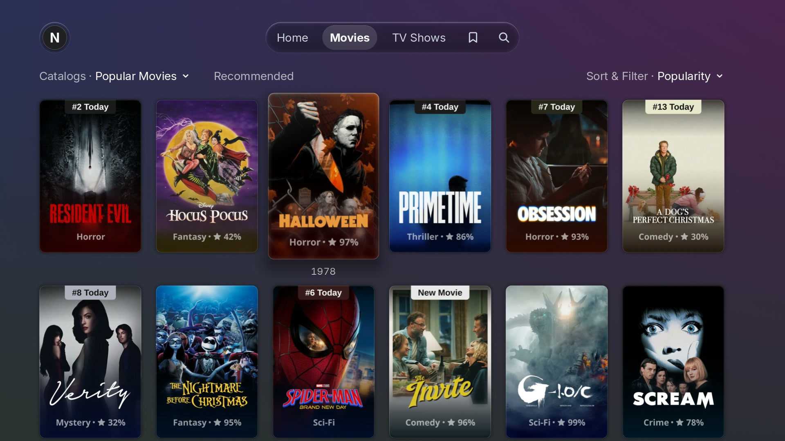
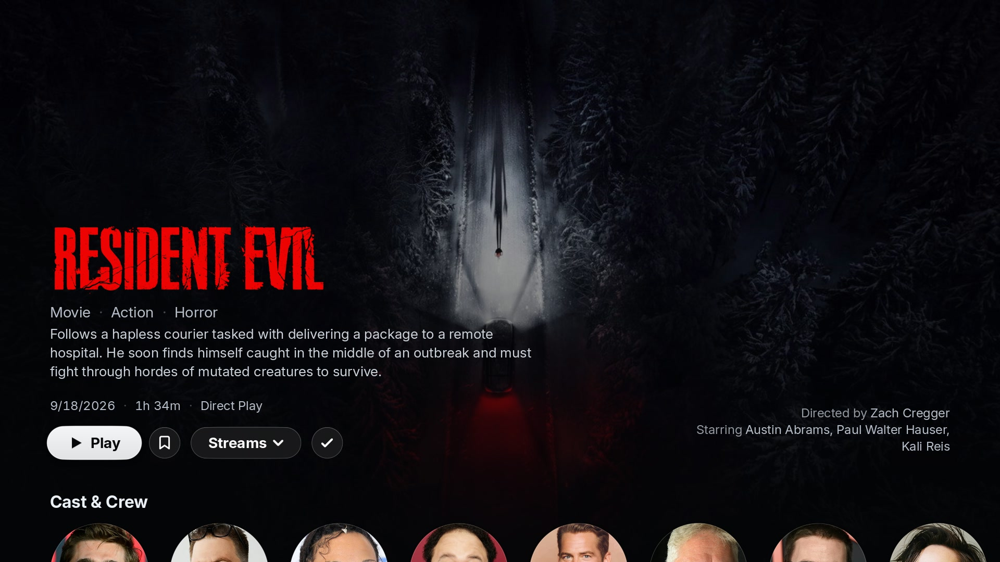
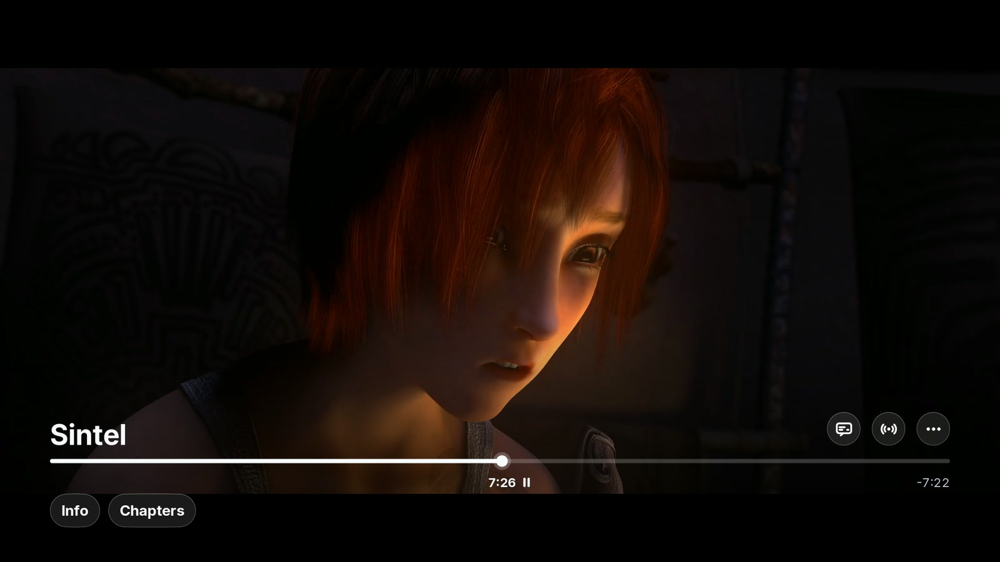
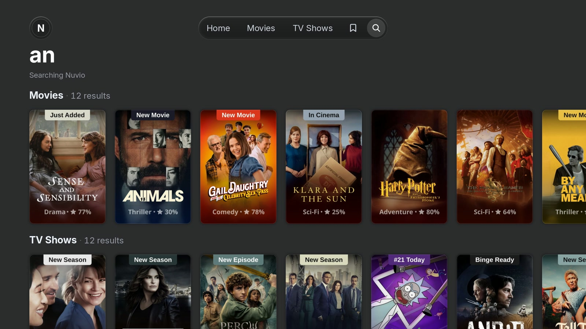
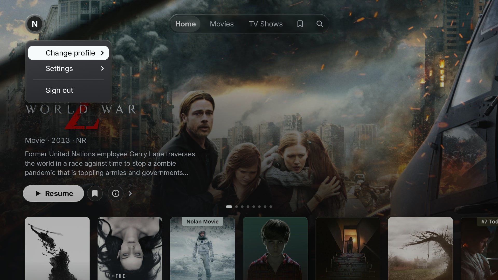

# Nuvio Native

**A native LG webOS client for Stremio and Nuvio addons.** It browses the catalogs you already
have, shows the streams your addons return, and plays the chosen file on the television's own
decoder — with the remote, no phone, no browser.



Nuvio Native is a fork of [RichiL10/plx-native](https://github.com/RichiL10/plx-native), itself
based on [PlxNative](https://github.com/GLinnik21/plx-native) by
[Gleb Linnik](https://github.com/GLinnik21). It keeps PlxNative's GPU-rendered interface and its
native Starfish/ACB video pipeline, and replaces the Plex data layer with an in-process server
that speaks the Plex HTTP dialect over Stremio addons and your Nuvio account. There is no Plex
Media Server, no plex.tv sign-in and no transcoding.

## What it does

- **Your addons, as a library.** The catalogs of your addons (Cinemeta, Torrentio, AIOStreams and
  the rest) become Home shelves and a poster grid, one per catalog, with the standard genre,
  sort and filter menus on top.
- **Every stream in one menu.** Streams are grouped by the addon that answered, with seeders,
  resolution, codec, HDR and size on each row, and the same picker is on the detail page, on the
  Home hero and inside the player.
- **A Nuvio account, signed in from the TV.** Sign-in is a QR code and a code. The app imports
  the addons installed on the account and keeps **My List** and **watch progress** there, so the
  next episode resumes on any device that uses the same profile.
- **Torrents and direct links.** An `infoHash` plays through the bundled streaming engine;
  debrid-resolved HTTP links (Torrentio, AIOStreams, …) play directly. The original file is
  played as it is — the app has no transcoder.
- **Detail pages worth opening.** Cast and person pages, More Like This, collection shelves,
  title logos, and the trailers the title's metadata lists — played from the video's own DASH
  tracks, with no embedded web player.
- **A player that uses the set.** Dolby Vision Profile 7 converted to 8.1, in-app audio lanes for
  TrueHD, DTS and FLAC, Opus direct, playback speed from 0.5× to 2×, text and image subtitles
  with an external subtitle search, chapters, Up Next and resume.
- **Eight interface languages:** English, Español, Беларуская, Français, Italiano, Português,
  Deutsch and Magyar.

## Screenshots

| | |
|---|---|
| <br>Library | <br>Addon catalogs |
| <br>A title's page | <br>The player |
| <br>Search | <br>The account menu |

The app renders all of them. Home, Library, the catalog grid, Search and the account menu are
captures of a signed-in Nuvio account on the desktop simulator, so the shelves, catalogs and
posters are what that account's addons returned, and the `Streams ▾` control on the title page is
the addon-grouped picker. That artwork belongs to the rights holders of the titles it shows and
appears here only to identify the work the app is displaying — the same way the app shows it on
the television; it is not covered by this repository's licence. The player figure is shot against
a demo library of openly licensed films. Everything this repository *generates* — the demo-library
figures and their credits — is openly licensed and listed in
[docs/screenshots/CREDITS.md](docs/screenshots/CREDITS.md).

## What you need

- An LG television running **webOS 4.0 or newer** (the 32-bit ARM package; playback has been
  verified on one set, see [compatibility](docs/nuvio/RELEASE-NOTES-v0.9.0.md#compatibility)).
- A **Nuvio account** with the addons you want to use.
- Nothing else: no Plex server, no separate torrent service, no account on a computer.

## Install

No release has been published yet. The `.ipk` is built by
[`build-ipk.yml`](.github/workflows/build-ipk.yml) and attached to a
[release](https://github.com/Rofocale11/nuvio-native/releases); install it with
[webOS Dev Manager](https://github.com/webosbrew/dev-manager-desktop) over LG's Developer Mode
(no root needed) or, once the app is in it, with the
[Homebrew Channel](https://github.com/webosbrew/webos-homebrew-channel).

Developer Mode expires if it is not renewed, and LG then removes the apps installed through it.

## Build from source

The Rust workspace is in `rust-modules/`; the C shims and the video pipeline are in `src/`.

```sh
git clone https://github.com/Rofocale11/nuvio-native
cd nuvio-native
make -j10 sim-linux     # host simulator (needs a graphical session)
make ipk                # the ARM package; needs the webOS NDK
```

`make sim-linux` builds and links the desktop simulator; `./tools/ai-sim.sh` launches it with the
standard environment. The ARM package needs the webOS NDK, and a host-only build proves nothing
about the television. `docs/building.md` has the prerequisites, the toolchain and every target.

## Documentation

| document | what it covers |
|---|---|
| [docs/nuvio/FEATURE.md](docs/nuvio/FEATURE.md) | everything the fork adds to PlxNative, in detail |
| [docs/nuvio/ARCHITECTURE.md](docs/nuvio/ARCHITECTURE.md) | system shape, crates and the fork's constraints |
| [docs/nuvio/PLAYBACK.md](docs/nuvio/PLAYBACK.md) | the stream-to-decoder path, audio lanes and memory |
| [docs/nuvio/ID-MANAGEMENT.md](docs/nuvio/ID-MANAGEMENT.md) | how addon items become numeric Plex keys |
| [docs/nuvio/WATCH-PROGRESS.md](docs/nuvio/WATCH-PROGRESS.md) | My List, watch state and the account mirror |
| [docs/README.md](docs/README.md) | the index, which marks upstream pages as references |

The app ids are `com.nuvionative.app` (stable) and `com.nuvionative.app.debug` (debug).

## What it is not

Nuvio Native is **not a Plex client**. It has no plex.tv credential and no Plex Media Server; the
UI merely speaks the Plex HTTP dialect to a loopback server in the same process. It is not a
media server and does not download or host anything for you: every stream comes from the addon
that answered, and every addon is operated by whoever publishes it.

Your catalogs, posters and streams come from the addons you install — Cinemeta, Torrentio,
AIOStreams, a poster addon, whichever ones your account has — and on some pages from The Movie
Database. Nuvio Native uses the TMDB API but is not endorsed or certified by TMDB, and the artwork
it displays remains the property of each title's rights holder.

It is unofficial and is not affiliated with, endorsed by, or sponsored by Plex GmbH, LG
Electronics or Nuvio.

Your Nuvio sign-in, your My List and your watch progress are kept on your Nuvio account; the
addons you install see the requests they answer, and they are operated by whoever publishes them.
[`PRIVACY.md`](PRIVACY.md) says exactly what the app stores on the television and what leaves it.

## Licence and attribution

[GPL-3.0-or-later](LICENSE), © 2026 Gleb Linnik; the fork's changes are under the same licence.
The PlxNative name and its brand artwork are excluded from that grant — see
[`TRADEMARKS.md`](TRADEMARKS.md), which also carries the Plex, LG and Nuvio non-affiliation
statements. The film and television artwork visible in the screenshots is excluded too: it belongs
to the rights holders of those titles and is shown to identify them. Third-party components and
their licences are listed in
[`THIRD-PARTY-NOTICES.md`](THIRD-PARTY-NOTICES.md) and `licenses/`, and those notices ship inside
the `.ipk` too.

The upstream project's README describes the Plex client this fork came from, not this app; it is
kept for attribution in [docs/upstream-readme.md](docs/upstream-readme.md).
